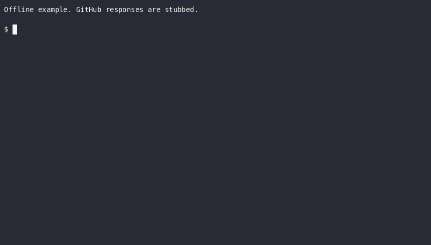

# trade-tariff-tools

This repository provides shared GitHub Actions workflows, composite actions and
operational commands for the Trade Tariff team. Other repositories consume these
interfaces, so changes must preserve compatibility or coordinate a migration.

- [.github/workflows/](.github/workflows/): reusable workflows and automation.
- [.github/actions/](.github/actions/): composite actions.
- [bin/](bin/): public commands.
- [scripts/](scripts/): implementations and internal helpers.
- [tests/](tests/): Bats regression tests.

Read [CONTRIBUTING.md](CONTRIBUTING.md) for the fork workflow, review process and
private security reporting. Operational commands can run jobs, change data or
remove AWS resources. Confirm the target account and obtain approval before
using a command that changes shared resources.

## Setup Guide

### Prerequisites

- **Python 3.11.4+** (or recent 3.x)
- **pip** (Python package manager)
- **For the `ecs` script:**
  - AWS CLI configured with credentials
  - Session Manager Plugin
  - `jq` (JSON processor)
  - `fzf` (fuzzy finder)

### Installation Steps

1. **Install Python dependencies:**

   ```bash
   python3 -m venv .venv
   source .venv/bin/activate
   python3 -m pip install requests openpyxl
   ```

2. **Install system dependencies (for macOS):**

   ```bash
   # Install AWS CLI
   brew install awscli

   # Install Session Manager Plugin
   brew install session-manager-plugin

   # Install jq (JSON processor)
   brew install jq

   # Install fzf (fuzzy finder)
   brew install fzf
   ```

3. **Configure AWS credentials (for `ecs` script):**
   - Use the approved role through the [AWS access portal](https://d-9c677042e2.awsapps.com/start/).

4. **Verify Session Manager Plugin installation:**

   ```bash
   session-manager-plugin
   ```

   You should see usage information if it's installed correctly.

## Check changes

Run `bats tests` for the shell regression suite. Use `bash -n` on changed Bash
scripts and `shellcheck` for static analysis. See [AGENTS.md](AGENTS.md) and
[CI](.github/workflows/ci.yml) for the full command list.

AWS access is not needed just to review documentation. Do not run the operational
examples below as smoke tests against a shared account.

## Require a Jira ticket

`.github/workflows/require-ticket.yml` fails a pull request that changes files
under `app/` when the description names no Jira ticket. It is built to run as an
organisation-required workflow, so no repository needs its own copy.

The check passes without a ticket when any of these is true:

- The author is `dependabot[bot]`.
- The pull request has the `no-ticket` label.
- No changed file is under `app/`.
- The base branch has no `app/` folder.

Ticket keys are `HMRC-123`, `AI-123` or `HOTT-123`. To change the prefixes, edit
`TICKET_PREFIXES` in the workflow. The check ignores HTML comments, so the
placeholder text in the pull request template does not count as a ticket.

The workflow has no `paths:` filter on purpose. A required check that a filter
skips stays pending and blocks the merge. The script decides inside the job.
The script is inline because an org-required workflow cannot check out this
repository. `tests/require-ticket.bats` extracts it from the workflow and runs it.

### Deploy it

You need to be an owner of the `trade-tariff` GitHub organisation.

1. Merge the pull request that adds the workflow to `main`. A ruleset runs the
   workflow from the branch you choose, so `main` is the right one.
2. Create the `no-ticket` label in every repository the ruleset targets. A ruleset
   does not create labels.

   ```bash
   gh label create no-ticket --repo trade-tariff/<repo> \
     --description "PR needs no Jira ticket" --color ededed
   ```

3. In GitHub, open the organisation **Settings > Rules > Rulesets** and choose
   **New ruleset > New branch ruleset**.
4. Name it `Require Jira ticket`. Set **Enforcement status** to **Evaluate**.
5. Under **Target repositories**, pick the Rails repositories: `trade-tariff-backend`,
   `trade-tariff-frontend`, `trade-tariff-admin`, `trade-tariff-dev-hub`, `identity`
   and `mcp`.
6. Under **Target branches**, choose **Include default branch**.
7. Turn on **Require workflows to pass before merging**. Add
   `trade-tariff/trade-tariff-tools`, the path `.github/workflows/require-ticket.yml`,
   and the ref `refs/heads/main`.
8. Save the ruleset. In **Evaluate** mode, results show under **Insights** and
   nothing blocks a merge.
9. Open a test pull request in `trade-tariff-github-testing`, or a repository with
   an `app/` folder. Check that the workflow runs and that the result is right
   with a ticket, without one, and with the `no-ticket` label.
10. After a week or two, set **Enforcement status** to **Active**.

### Roll back

Set the ruleset to **Disabled**, or delete it. Nothing else depends on the
workflow, so no repository needs a change.

## Licence

The code and associated documentation use the [MIT licence](LICENCE.md), with
Crown copyright (HM Revenue & Customs). Dependencies and third-party actions
retain their own licences.

## Usage Guide

### E2E workflow projects

The reusable `deploy-ecs-v2.yml` and `deploy-multi-ecs-v2.yml`
workflows accept `test-projects`. The reusable `e2e-tests-v2.yml` workflow
accepts `projects`. These inputs default to `api,frontend`.

These workflows are additive. The existing `deploy-ecs.yml`,
`deploy-multi-ecs.yml`, `e2e-tests.yml` and `e2e-fpo-tests.yml` workflows are
unchanged. They keep `test-flavour`, `skip-admin`, `skip-dev-hub` and
`skip-myott`. Existing callers do not need to change.

Use a comma-separated list of `api`, `admin`, `frontend`, `dev-hub`, and `myott`.
Spaces around names are optional. For example, use `test-projects: 'api,myott'`
to test the API and MyOTT after deployment.

Set `test-projects: ''` to skip E2E tests during deployment. Multi-app deployment
skips E2E tests for each app and runs the selected projects once after all apps
deploy. A direct E2E workflow call rejects an empty `projects` value.

The E2E suite does not enable `admin`, `dev-hub`, or `myott` when
`skip-passwordless` is `true`, or in production. The launcher removes these
projects with a warning. If none remain, it skips the E2E tests.

The E2E workflow always honours `skip-passwordless`, which defaults to `true`,
regardless of the selected projects. Set `skip-passwordless: false` when
passwordless verification is needed, such as for passwordless journeys in
`admin`, `dev-hub`, or `myott`. Callers must provide the environment access that
the selected projects need.

**Migration (optional):** To move to project selection, change the called
workflow to its `-v2` equivalent. Replace `test-flavour: tariff` with
`test-projects: 'api,frontend'`, or select the projects that the deployment
needs. Replace `test-flavour: none` with `test-projects: ''`. Replace the E2E
inputs `skip-admin`, `skip-dev-hub`, and `skip-myott` with an explicit
`projects` list. The `-v2` workflows do not run the FPO E2E suite.
Callers that need it keep using `deploy-ecs.yml` with `test-flavour: fpo`.

### 1. `bin/fetch-commodities`

Fetches commodity codes and descriptions from the Trade Tariff service API and generates a markdown table.

**Setup:**

- Edit `commodities.txt` with your commodity codes (one per line)

**Usage:**

```bash
./bin/fetch-commodities
```

**Output:** Prints a markdown table with commodity codes and descriptions that can be copied into Stop Press Notices.

For example, this will produce:

| Commodity Code | Description |
| -------------- | ----------- |
| <a href="https://www.trade-tariff.service.gov.uk/commodities/3824999214" target="_blank">3824999214</a> | Other |
| <a href="https://www.trade-tariff.service.gov.uk/commodities/1516209831" target="_blank">1516209831</a> | Consigned from the United Kingdom |
| <a href="https://www.trade-tariff.service.gov.uk/commodities/1516209822" target="_blank">1516209822</a> | Consigned from the United Kingdom |
| <a href="https://www.trade-tariff.service.gov.uk/commodities/1516209823" target="_blank">1516209823</a> | Consigned from China |
| <a href="https://www.trade-tariff.service.gov.uk/commodities/1516209832" target="_blank">1516209832</a> | Consigned from China |
| <a href="https://www.trade-tariff.service.gov.uk/commodities/1518009122" target="_blank">1518009122</a> | Consigned from the United Kingdom |
| <a href="https://www.trade-tariff.service.gov.uk/commodities/1518009123" target="_blank">1518009123</a> | Consigned from China |
| <a href="https://www.trade-tariff.service.gov.uk/commodities/1518009131" target="_blank">1518009131</a> | Consigned from the United Kingdom |

### 2. `bin/ecs`

Interactive script to execute commands in AWS ECS tasks. Uses `fzf` for interactive selection of clusters, services, and tasks.

**Usage:**

```bash
# Interactive shell (default)
./bin/ecs

# Run a specific command
./bin/ecs 'bundle exec rails console'

# Run a rake task
./bin/ecs 'bundle exec rake tariff:jobs'

# Select and run a scheduled job from the current AWS account
./bin/ecs run

# Run a scheduled job by name from the current AWS account
./bin/ecs run backend-database-replication

# Run the replication job without prompts and without tailing logs
./bin/ecs run --yes --no-tail backend-database-replication

# Filter explicitly if a job name exists in more than one environment in the account
./bin/ecs run --environment staging --yes --no-tail backend-database-replication

# Fuzzy-select and dispatch a workflow in trade-tariff/trade-tariff-tools
./bin/ecs dispatch

# Dispatch a workflow from a specific branch or tag
./bin/ecs dispatch --ref main
```

`ecs run` discovers scheduled jobs from the AWS account represented by your
current credentials. Use `--environment` only as a filter when that account has
more than one matching environment.

`ecs dispatch` lists active workflows that support `workflow_dispatch` in
`trade-tariff/trade-tariff-tools`, regardless of your current directory. Select a
workflow with `fzf`, then confirm the workflow and ref. GitHub CLI prompts for
workflow inputs. The default ref is the repository's default branch.

This command requires `gh`, `jq`, and `fzf`. Authenticate `gh` with an account
that has permission to dispatch workflows. AWS credentials and Session Manager
Plugin are not required for this command.



**Features:**

- Interactive selection of clusters, services, and tasks using `fzf`
- Starts scheduled EventBridge-backed ECS jobs on demand with `ecs run`
- Dispatches GitHub workflows with fuzzy selection and confirmation using `ecs dispatch`
- Discovers scheduled jobs from the current AWS account credentials
- Resolves the latest active task definition before starting scheduled jobs
- Lists every job (`admin-job`, `backend-job`, `dev-hub-job`, `identity-job`, ...) next to the ECS services
- Reuses a running job task that has ECS Exec enabled, or starts a new one if none exists
- Automatically stops the job tasks that it started when you exit
- Sets `RAILS_LOG_LEVEL=debug` for all commands

**Note:** The script requires Session Manager Plugin to be installed. If you encounter an error about SessionManagerPlugin not being found, install it using:

```bash
brew install session-manager-plugin
```

### 3. `bin/ott-search-stat`

Performs OTT (Online Trade Tariff) searches and outputs results to an Excel file.

**Setup:**

- Edit `queries.txt` with your search queries (one per line)

**Usage:**

```bash
./bin/ott-search-stat
```

**Output:** Creates `search_results.xlsx` with three sheets:

- "Commodity Match" - Top 5 commodity matches
- "Results" - Reference match results
- "Other Results" - Other search results

**Configuration:** The script currently points to `http://localhost:3000`. You may need to modify the `url` variable in the script (line 32) to point to your desired environment.

### 4. `bin/cleanup-ecs-families`

This script reports on and optionally deregisters unused Amazon ECS task definition families. It is designed to help keep your ECS task definitions clean by identifying and removing old, inactive families that are no longer associated with active services or recently run tasks.

**Important Safeguards:**

- Task definition families ending in `-job` are preserved from family cleanup, because scheduled job families are not necessarily attached to ECS services.
- It also considers families of recently running or stopped tasks as 'in-use' for a short period.

**Usage:**

```bash
# Report mode (default): Lists unused task definition families without making any changes.
./bin/cleanup-ecs-families report

# Deregister mode: Deregisters the identified unused task definition families.
./bin/cleanup-ecs-families deregister [--family FAMILY_NAME] [--environment ENV_NAME]
```

**Options:**

- `--family FAMILY_NAME`: Target a specific task definition family for reporting or deregistration.
- `--environment ENV_NAME`: Specify the environment (e.g., `development`, `staging`, `production`). Defaults to `development`.

### 5. `bin/rotate-task-definitions`

Deregisters old, unused ECS task definition revisions, keeping a specified number of recent revisions and all currently in-use revisions.

**Usage:**

```bash
./bin/rotate-task-definitions [number_to_keep]
```

The `number_to_keep` argument is optional and defaults to 4. All revisions currently in use by services or running tasks are always preserved, regardless of this number.

When AWS returns task definitions for a family prefix, the script only deregisters revisions whose exact family matches the family currently being rotated.

### 6. `bin/healthcheck`

Checks the public healthcheck endpoint of every Trade Tariff service and prints a table. Use it in the first minutes of an incident to see which service, and which backend dependency, is down. See the [Incident Triage Playbook](https://transformuk.atlassian.net/wiki/spaces/HO/pages/22703636484/Incident+Triage+Playbook).

It checks the frontend, backend UK and XI, admin, hub, identity, MCP, Flagsmith, Flagsmith edge and FPO search. The backend rows show Postgres, Redis, OpenSearch and Sidekiq. It sends public HTTP requests only, so it does not need AWS credentials. It needs `curl` and `jq`.

**Usage:**

```bash
./bin/healthcheck                 # production
./bin/healthcheck staging
./bin/healthcheck all             # development, staging and production
./bin/healthcheck --timeout 5 production
FPO_API_KEY_PRODUCTION=KEY ./bin/healthcheck production   # also checks FPO search
```

Replace `KEY` with the FPO search API key. An FPO API key works in one environment only, so each environment has its own variable: `FPO_API_KEY_DEVELOPMENT`, `FPO_API_KEY_STAGING` or `FPO_API_KEY_PRODUCTION`. The command sends each key only to its own environment. If an environment has no key, the command skips its FPO search check.

The command exits with 1 if any check fails. A failed row shows the CloudFront `x-cache` header when there is one. `Hit from cloudfront` means CloudFront cached an error.
